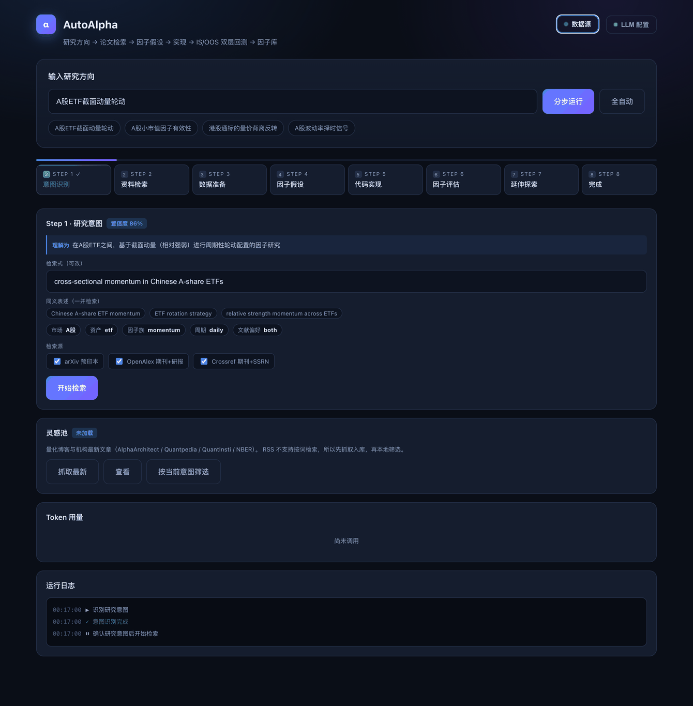
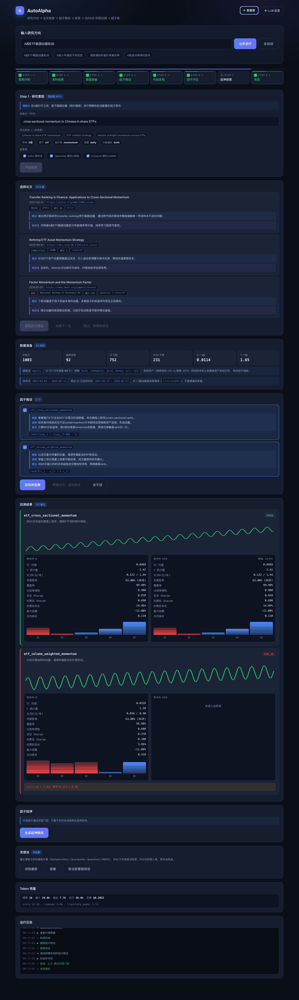

# AutoAlpha

**An autonomous quant-research agent — from one research direction to a factor that survives scrutiny.**

[](https://github.com/EdisonFu/autoalpha/actions/workflows/tests.yml)
[](https://github.com/EdisonFu/autoalpha/actions/workflows/lint.yml)
[](LICENSE)
[](pyproject.toml)

English · [简体中文](README.md)

Give it a research direction. It runs a full research cycle on its own:

```
intent → retrieval → data prep → hypotheses → codegen → evaluation → extension
  ↓          ↓           ↓            ↓          ↓           ↓           ↓
canonical  3 sources  universe   data-avail   sandboxed   IS/OOS     variant
 phrasing  + dedupe   + derived    precheck   + self-fix  two-stage   search
                       gates                              gating
```

This is not "ask an LLM for a factor formula". Each stage is an agent that
operates under constraints, checks its own output, and recovers from failure:
retrieval judges relevance, extraction is told what data actually exists,
generated code must run in a sandbox and pass shape checks, and evaluation has
to survive out-of-sample.

---

## Why it exists

Generating factors with an LLM is easy. Knowing **which ones to trust** is not.

Here is a factor this pipeline actually produced. Its IC is positive and its
monthly win rate is 66% — under the usual IC/ICIR gates it would be accepted
into a factor library. Its quintile returns:

```
Q1 +5.4%   Q2 +2.6%   Q3 -2.3%   Q4 +7.5%   Q5 -6.3%
                                            ↑ the top quintile is the worst
```

The gains sit in the middle quintiles, so a long-short book built on it misses
exactly the layers that earn. **A significant IC does not mean a factor earns.**
IC is a rank correlation and carries no magnitude, so its divergence from
layered returns is expected — and invisible if IC is all you measure.

The literature turned to this problem through 2026. [2608.27734] tested two
frontier models over 100 candidates with five repeats and reported that
*"honest evaluation certifies passive benchmarks, **rejects every
LLM-discovered strategy**"*.

**So the weight of this project is on evaluation, not generation.** Most
comparable tools stop at IC/ICIR; this one adds a full backtest layer and
two-stage gating:

| | Typical LLM factor miner | AutoAlpha |
|---|---|---|
| Metrics | IC / ICIR | plus layer monotonicity, long-short Sharpe, turnover, net-of-cost return |
| Out-of-sample | often absent | split held by the engine; the search loop **cannot reach** OOS |
| Thresholds | hardcoded constants | derived from cross-section width, so they adapt to the dataset |
| Deduplication | IC-series correlation | portfolio NAV correlation (the former misses same-family factors) |
| Data constraints | none | availability injected at extraction; inventing proxies is forbidden |

---

## What is technically interesting

**Retrieval is not keyword matching.** The same intent phrased differently
differs by 800x in recall — `ETF轮动` returns 18 hits while the canonical
English phrasing returns 14,494. So intent is normalised first, then three
sources run in parallel (arXiv preprints, OpenAlex reports, Crossref/SSRN
working papers) and are deduplicated across sources.

**Code generation has a repair loop.** Generated code runs in a subprocess
sandbox. Failures are classified (syntax / runtime / data / timeout) and fed
back as targeted repair guidance. Two shape checks sit in front of the
backtest: date sparsity and cross-sectional degeneracy — factors that run
fine and emit a valid CSV while their IC is identically zero.

**Leakage prevention is structural, not conventional.** The split lives in
`SplitEngine`; the repair loop and experience memory only ever see in-sample
data, and OOS is read once per factor. Statistical correction does not catch
look-ahead bias: a deliberately leaky oracle posting a Sharpe of 35 passes
Deflated Sharpe and PBO testing **completely**.

**Cost is bounded.** A full run measures at $0.15–0.22
([breakdown](docs/TOKEN_COST.md)). Paper scoring once accounted for 84.5% of
it; capping the scored set cut search-stage cost by 52% with no visible effect
on recall.

---

> ⚠️ **Disclaimer**: this is a research tool, not investment advice.
> **Passing the gates does not mean a factor is fit for live trading** — gates
> rule out results that are not credible; they cannot establish profitability.
> See [DISCLAIMER.md](DISCLAIMER.md).

---

## Quick start

### Try it without an API key

```bash
git clone https://github.com/EdisonFu/autoalpha.git
cd autoalpha
pip install -e .
python main.py --web --demo
```

Open http://127.0.0.1:8000 and step through a complete run with preloaded
sample results, including the factor above. Nothing is called out to; the data
is clearly marked as a demonstration.

### Run it for real

```bash
pip install -e ".[anthropic]"      # or ".[openai]"

export LLM_API_KEY=...             # your key
export LLM_MODEL=<model-id>        # model id
python main.py --web
```

Data platform SDKs are optional. With none installed the pipeline uses public
data interfaces; configure an account and it prefers your platform. Key, model,
base URL and data sources are all editable in the UI.

---

## Interface

See the [Chinese README](README.md#界面一览) for the full walkthrough with
screenshots of every stage.





---

## Evaluation gates

```
IS   |t| > derived threshold · monotonicity > 0.6 · LS Sharpe > 0.5
     · coverage > 0.7 · turnover < frequency-calibrated cap
OOS  net Sharpe > 0.3 · Sharpe decay > -50% · monotonicity > 0.4
     · NAV correlation < 0.7
```

Thresholds are derived rather than fixed: `ic_mean_floor = t / sqrt(n_obs) /
sqrt(width)`. A hardcoded 0.02 came from a 24-asset universe; at 92 assets it
is 2.3x too strict, and nothing in the code recorded that coupling.

Expect most factors to fail. That is the gates working — with weak signals,
admission rates of 1–7% are what the literature reports.

---

## Documentation

| File | Contents |
|---|---|
| [CLAUDE.md](CLAUDE.md) | Development guide: invariants and traps worth knowing first |
| [CONTRIBUTING.md](CONTRIBUTING.md) | How to contribute |
| [docs/P0_BACKTEST_DESIGN.md](docs/P0_BACKTEST_DESIGN.md) | Backtest layer design and implementation notes |
| [docs/E2E_REVIEW.md](docs/E2E_REVIEW.md) | End-to-end review and measured findings |
| [docs/TOKEN_COST.md](docs/TOKEN_COST.md) | Measured cost breakdown and levers |
| [README_WEB.md](README_WEB.md) | Web console usage |

## License

MIT — see [LICENSE](LICENSE).
