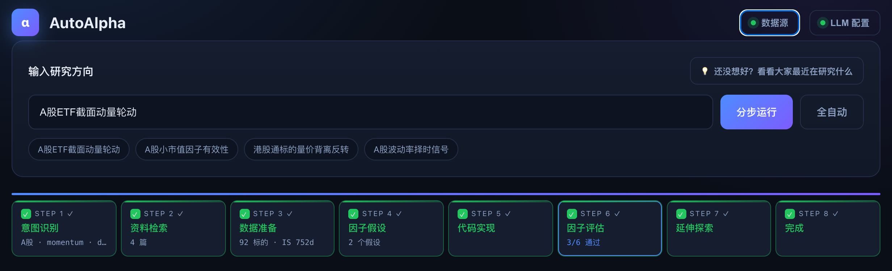
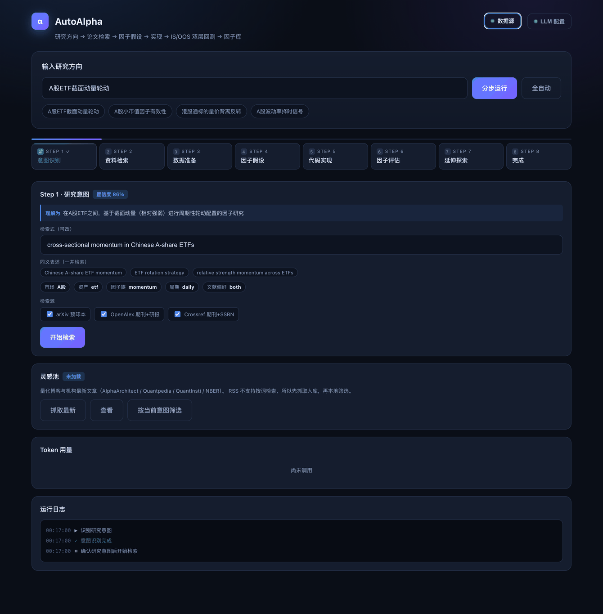
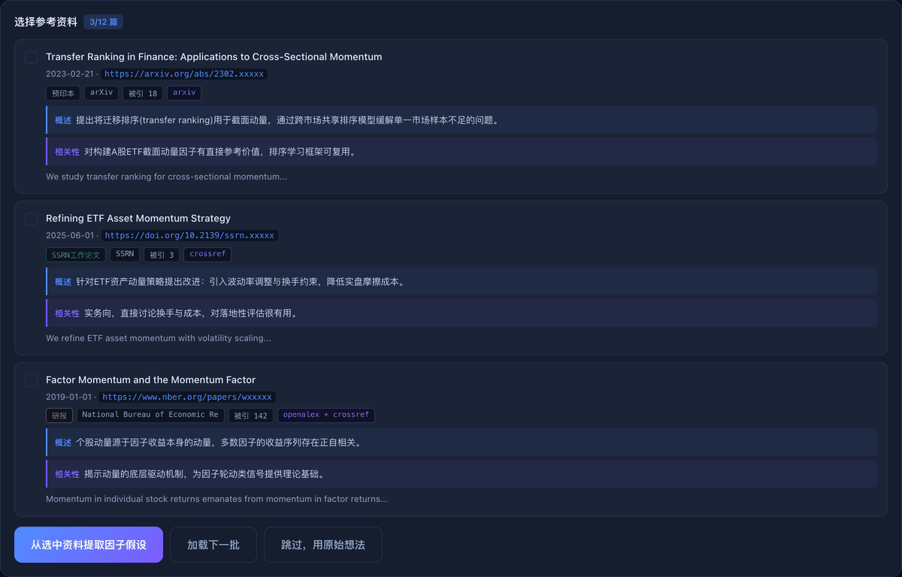
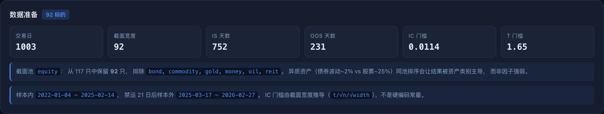
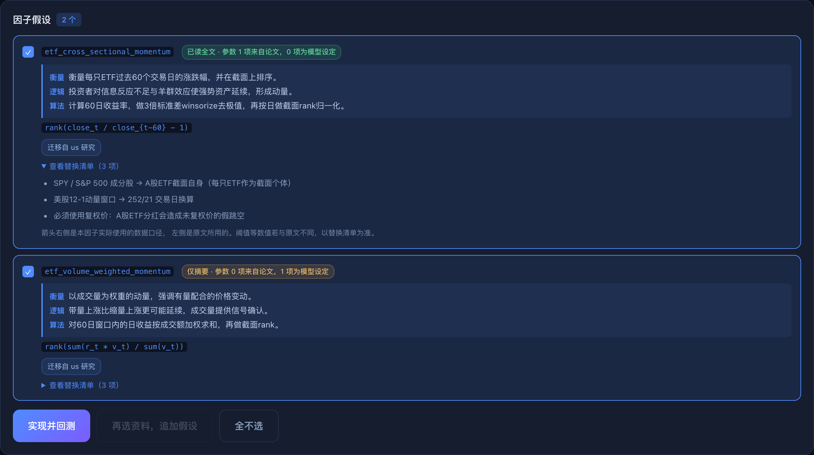
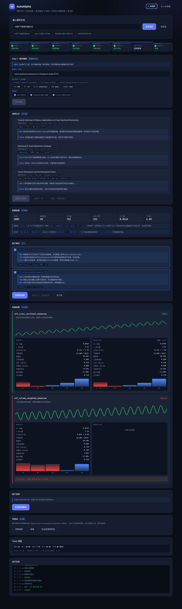
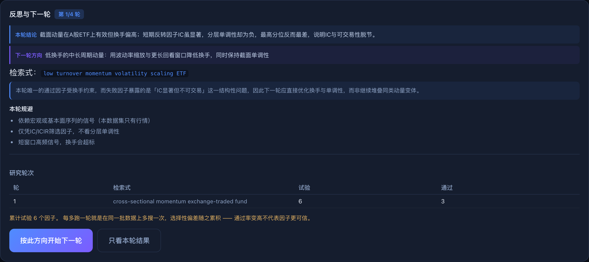

# AutoAlpha

**LLM 多智能体驱动的自动化因子挖掘系统 —— 一句研究方向，产出经得起样本外检验的 Alpha 因子。**

[](https://github.com/EdisonFu/autoalpha/actions/workflows/tests.yml)
[](https://github.com/EdisonFu/autoalpha/actions/workflows/lint.yml)
[](LICENSE)
[](pyproject.toml)

[English](README.en.md) · 简体中文

```
                    输入：「A股ETF截面动量轮动」
                                ↓
  ┌──────────────────────────────────────────────────────────┐
  │  意图 Agent    口语 → 规范学术检索式 + 市场/资产/周期识别    │
  │  检索 Agent    arXiv + OpenAlex + Crossref 并联 → 语义排序  │
  │  概述 Agent    批量生成中文概述与相关性判断                  │
  │  提取 Agent    论文 → 可计算的因子假设（注入数据约束）        │
  │  实现 Agent    假设 → Python 代码 → 沙箱执行 → 定向自修复    │
  │  评审 Agent    语义层面核查：经济逻辑 / 实现保真 / 过拟合风险 │
  │  延伸 Agent    围绕通过的因子生成变体 + Jaccard 多样性过滤    │
  │  反思 Agent    读本轮失败原因 → 规划下一轮方向（主循环）        │
  └──────────────────────────────────────────────────────────┘
                                ↓
            确定性引擎：IS/OOS 双层门控 → 因子库
                                ↓
        反思本轮 → 重写检索式 → 回到意图识别（最多 4 轮，全程记账）
```

**8 个 LLM 智能体负责「生成与判断」，1 个确定性引擎负责「裁决」。**
智能体可以犯错、可以幻觉、可以写出跑不通的代码 —— 引擎不会放行。
切分、成本、门槛由引擎强制，智能体无法协商。

---

## 它解决什么问题

量化研究的真实瓶颈不是想不出因子，而是**三件事都很贵**：

| 人工做法 | 耗时 | AutoAlpha |
|---|---|---|
| 查文献：读摘要、判断是否相关、翻译 | 数小时/批 | 三源并联召回 110 篇，带中文概述与相关性判断 |
| 从论文到可运行代码：理解公式、对齐数据、调试 | 数小时/个 | 沙箱执行 + 按错误类型定向自修复 |
| 严谨评估：分层、换手、扣费、样本外 | 容易偷懒 | 引擎强制，无法跳过 |

一轮完整研究实测 **1–2 分钟、$0.15–0.22**（4 个因子，含检索与代码生成），
产出可追溯到源文献的因子代码与完整回测。

### 技术上难在哪

**不是「让 LLM 写个公式」。** 这条链上每一步都有具体的工程约束：

- **检索** —— 同一意图不同表述召回量差 **800 倍**（`ETF轮动` 18 篇 vs 规范英文 14,494 篇），
  所以必须先做术语归一；且不同市场结论不能平移，要识别市场并加限定
- **代码生成** —— LLM 产出的代码在 subprocess 沙箱执行，失败按
  `NO_MAIN / SYNTAX / RUNTIME / DATA / TIMEOUT / LOGIC` 分类，
  把**定向**修复建议回传重试，而不是笼统地说「报错了」
- **形状校验** —— 两道检查拦在回测前：日期稀疏、截面退化。
  这类因子代码能跑、CSV 正常，但 IC 恒为 0
- **防泄漏** —— 切分由引擎持有，修复回路与经验记忆只能看 IS。
  统计修正抓不住前瞻偏差：一个故意泄漏的 oracle 打出 Sharpe 35，
  **完整通过了** Deflated Sharpe 与 PBO 检验
- **经验记忆** —— 失败模式落库，下次生成同类因子时作为上下文注入，
  避免重复踩同一个坑

---

## 为什么重心在评估

LLM 生成因子很容易 —— 难的是**判断哪个因子值得信**。

这是一个真实跑出来的例子。某动量因子 IC 为正、月度胜率 66%，
按常见的 IC/ICIR 门控会判定「有效」并入库。但它的分层年化收益是：

```
Q1 +5.4%   Q2 +2.6%   Q3 -2.3%   Q4 +7.5%   Q5 -6.3%
                                            ↑ 最高分位反而最差
```

收益堆在中间层，多空组合恰好错过赚钱的层。**IC 显著 ≠ 能赚钱** ——
IC 是秩相关，不含收益幅度信息，与分层收益脱节是已知现象。

2026 年下半年的文献集体转向了这个问题。[2608.27734] 用两个前沿模型、
100 个候选 × 5 次重复实测后写道：*"honest evaluation certifies passive
benchmarks, **rejects every LLM-discovered strategy**"*。

**所以本项目的重心不在生成，在评估。**

| | 多数 LLM 挖因子项目 | AutoAlpha |
|---|---|---|
| 评估口径 | IC / ICIR | + 分层单调性、多空 Sharpe、换手、扣费后收益 |
| 样本外 | 常缺失 | IS/OOS 切分由引擎持有，搜索阶段**无法访问** OOS |
| 门槛 | 硬编码常量 | 由截面宽度推导，换数据集自动适配 |
| 去重 | IC 序列相关 | 组合净值相关（实测前者漏判同族因子） |
| 数据约束 | 无 | 提取阶段注入可用数据，禁止编造代理变量 |
| 语义审查 | 无 | 独立评审 agent，解析失败时拒绝而非放行 |

---

## 快速开始

### 先看效果（无需 API Key）

```bash
git clone https://github.com/EdisonFu/autoalpha.git
cd autoalpha
pip install -e .
python main.py --web --demo
```

打开 http://127.0.0.1:8000 点「播放演示」，用预置样例重放一轮完整流程 ——
包括上面那个 IC 为正但最高分位最差的因子。不发起任何外部调用。

### 跑真实流水线

```bash
pip install -e ".[anthropic]"      # 或 ".[openai]"

export LLM_API_KEY=...             # 你的密钥
export LLM_MODEL=<model-id>        # 模型 ID
python main.py --web
```

密钥、模型、数据源都可在页面上配置，不必改环境变量。
单价由模型 ID 自动识别，不用自己查。

**配置可以记住。** 在「LLM 配置」里勾选「记住配置」，或直接
`cp .env.example .env` 填好。之后重启自动加载，不用每次重填：

```bash
cp .env.example .env      # 填入 LLM_API_KEY / LLM_MODEL / LLM_BASE_URL
python main.py --web      # 启动时会打印「已加载本地配置 …/.env」
```

优先级：**进程环境变量 > 项目 `.env` > `~/.autoalpha/.env`**，
所以临时换模型直接 `export LLM_MODEL=...` 即可，不必改文件。
`.env` 已在 `.gitignore` 中、写入时权限设为 `600`，不会进版本控制。

---

## 界面一览

截图均为真实运行界面，`scripts/capture_screens.py` 可重新生成。



一句话输入，八步跑完 —— 步骤条上每一步都带着它的产出：
意图识别出「A股 · momentum · daily」，检索召回 3 篇，数据准备 92 个标的 /
IS 752 天，提取 2 个假设，评估 3/6 通过门控。点任意一步可展开该步详情。

输入时**建议带上市场**（如「A股」「港股」）——
不同市场的涨跌停、散户占比、做空限制差异很大，一个市场成立的结论往往不能平移。
还没想好？点输入框右侧的「看看大家最近在研究什么」，从量化圈最新文章里挑一条。

### Step 1 · 意图识别



把口语化输入归一成规范学术检索式，并识别市场、资产类别、因子族、周期。
这一步的理由很具体 —— 同一意图不同表述，召回量差 **800 倍**：

| 检索式 | 命中 |
|---|---|
| `ETF轮动` | 18 |
| `ETF rotation momentum` | 811 |
| `cross-sectional momentum exchange-traded fund` | 14,494 |

系统用中文复述它的理解，**识别错了可以在检索前直接改**。

### Step 2 · 资料检索



三个源并联，召回的不只是论文：

| 源 | 覆盖 |
|---|---|
| arXiv | q-fin 预印本 |
| OpenAlex | 期刊 + 学位论文 + **机构研报**（NBER、Econstor） |
| Crossref | 期刊 + **SSRN 工作论文**（DOI 前缀 `10.2139`） |

实测单次召回 115 条、跨源去重后 110 条。每篇带**中文概述**与**相关性判断**。
文献类型、期刊、被引数、命中来源都标在卡片上。资料多时可分批加载。

**缺摘要的条目会跨库补全。** 召回结果里相当一部分只有标题 ——
Crossref 缺 59%、OpenAlex 缺 32%。这些条目进 LLM 打分时只凭标题，
几乎必然被丢掉，SSRN 工作论文尤其吃亏（`How to Improve ETF Sector Momentum`
这类标题一看就对口，系统却一无所知）。

补法是**查另一家的库，不是爬出版商网页**：同一个 DOI 在 Crossref 缺的，
OpenAlex 往往有，反之亦然。实测两家零重叠、完全互补：

| 方案 | 新增依赖 | 补全率 | 耗时 |
|---|---|---|---|
| OpenAlex + Crossref 批量 DOI 回查 | 无 | **59%** | 4s |
| 抓出版商网页（urllib / curl_cffi / Scrapling 均同） | 0–900MB | 6% | 14–1147s |

爬网补不上是因为这些 URL 几乎全是 `doi.org`，解析到 Cloudflare 后大面积
超时；能连通的又多是 Elsevier / Wiley 的登录墙 —— 指纹伪装对「连不上」
和「内容不在页面上」都无效。

同时滤掉非研究条目（OECD 图表、书籍章节），它们占着打分配额还要花 token 评判。
合计效果：

```
          全文可读   有摘要   只有标题
改动前      62%       20%      18%
改动后      66%       29%       5%
```

### Step 3 · 数据准备



不只是读数据，还在做两件容易被忽略的事：

**按资产类别筛池。** 全池 117 只 ETF 的年化波动极差达 **200 倍**
（国债 0.2% vs 原油 39.8%）。混在一个截面里排序，结果会被资产类别主导
而不是因子强弱 —— 分层单调性这个核心判据就失去意义。只留股票类后极差降到 2.2 倍。

**门槛由数据推导。** `ic_mean_floor = t / √n_obs / √width`。
写死 0.02 是按 24 个标的算的；换成 92 个标的后它过严 2.3 倍。

### Step 4 · 因子假设



每个因子给出**衡量什么 / 经济逻辑 / 计算要点**。
提取时会把可用数据告知模型，并禁止自行编造代理变量 ——
曾出现过模型一边声称可计算、一边偷偷用已实现波动率替代 VIX，
还沿用美股校准的阈值。

**每个因子标注参数来源。** arXiv 论文会下载 PDF 正文、挑出方法论章节再提取；
其它来源正文在出版商登录墙后，只能用摘要。这个差别决定参数可不可信：

| | 回看窗口 | 分位切法 | 调仓频率 | 样本期 |
|---|---|---|---|---|
| 摘要（中位 833 字符） | ✗ | ✗ | ✗ | ✗ |
| arXiv 全文（约 8000 词） | ✓ | ✓ | ✓ | ✓ |

实测三篇论文，复现所需的 7 项细节在摘要里命中 **0–1 项**，全文里命中 **4–6 项**。
所以只读摘要时产出的 `lookback=20` 之类是**模型自己定的**，不是论文里的数字 ——
卡片上用琥珀色徽标「仅摘要 · 参数 0 项来自论文，1 项为模型设定」如实标出，
而不是让它看起来像复现了论文。

全文解析需 `pip install -e ".[fulltext]"`（pypdf，404KB），不装则全部走摘要并标注。

### Step 5 · 因子评估

每个因子跑完整分层回测：多空组合累计收益曲线（Y 轴为收益率）、
样本内外指标并排、各分位年化收益柱状图。IS 没过的因子**不会访问 OOS 数据**——
所以未通过的因子 OOS 栏显示「未进入此阶段」，而不是一组看起来也还行的数字。



图中第二个因子 `etf_reversal_overlay` 正是开头提到的情况：
IC 显著（t=2.10）但分层单调性 -0.30，最高分位反而最差 ——
只看 IC/ICIR 会把它当作有效因子收进库里。

### Step 6 · 延伸探索

通过门控的因子可作为基础，围绕它生成结构化变体：

- **参数变体** —— 不同窗口反映不同持有期，经济含义不同而非单纯调参
- **公式变体** —— 同一概念的另一种数学表达
- **正交组合** —— 与低相关因子组合，降低单一信号噪声

变体之间做 Jaccard 多样性过滤，避免只是换个参数名。
每个变体过同一套双层门控 —— **延伸不保证改进**，组合后换手升高、
扣费后不如基础因子的情况是常态。

### Step 7 · 反思，然后回到 Step 1



延伸只是参数微调，**auto research 的主循环在这里**。
每轮评估结束，系统读一遍所有因子的结局，据此规划下一轮查什么：

| 本轮失败模式 | 下一轮该做什么 |
|---|---|
| 需要宏观/基本面数据 | 只用 OHLCV，换不依赖外部数据的方向 |
| 换手率超标 | 找更低频、更平滑的信号 |
| 单调性不足 / IC 弱 | 换经济机制，不是换个窗口重试 |
| IS 通过但 OOS 衰减 | 优先稳健性与参数不敏感，而非更强的样本内拟合 |
| 有因子通过 | 深挖其经济逻辑，或找低相关的互补因子 |

方向由本轮的失败原因推出，**不是泛泛地再跑一遍**。
检索式随之重写，回到 Step 1 重新召回、补摘要、提取、实现、评估。

**循环必须记账，因为它有代价。** 每多跑一轮就是在同一批数据上多搜一次，
选择性偏差随之累积：4 轮试 40 个因子挑出 3 个，和首轮就挑出 3 个，
含义完全不同。界面会列出每轮的检索式、试验数、通过数与累计试验总数，
到轮次上限时明确提示这一点 —— **通过率变高不代表因子更可信**。

资料不对也可以在 Step 2 直接「换检索式重查」。
注意「加载下一批」取的是同一次检索里排名更靠后的，不会更相关。

---

## 因子评估门控

```
IS 层   |t| > 推导门槛 · 分层单调性 > 0.6 · 多空 Sharpe > 0.5
        · 覆盖率 > 0.7 · 换手 < 按频率校准的上限
OOS 层  扣费后 Sharpe > 0.3 · Sharpe 衰减 > -50%
        · 单调性 > 0.4 · 与已有因子净值相关 < 0.7
```

**换手上限按调仓频率校准**（日频 0.60 / 周频 0.40 / 月频 0.15）。
固定 0.30 会让日频因子永远不达标、月频轻松通过 —— 门槛变成频率的函数
而非因子质量的函数。

**预期大部分因子会失败。** 这是门控在工作 —— 弱信号区采纳率 1–7% 是文献报告的常态。

---

## 架构

```
autoalpha/
├── agents/
│   ├── intent_agent.py          Step 1：意图归一 + 市场识别
│   ├── paper_search_agent.py    Step 2：多源编排 + 语义排序
│   ├── translate_agent.py       中文概述（批量调用）
│   ├── factor_extract_agent.py  因子假设提取（注入数据约束）
│   ├── factor_implement_agent.py 代码生成 + 沙箱 + 自修复
│   ├── factor_extension_agent.py 延伸变体 + 多样性过滤
│   ├── factor_judge_agent.py    语义评审（fail-closed）
│   └── research_loop_agent.py   反思本轮 → 下一轮方向（auto research 主循环）
├── sources/
│   ├── arxiv.py / openalex.py / crossref.py   检索源
│   ├── base.py                  统一 schema + 跨源去重
│   ├── fulltext.py              arXiv 全文抓取 + 方法论章节抽取
│   ├── backfill.py              跨库补摘要 + 非研究条目过滤
│   └── feeds.py                 RSS 灵感池
├── engine.py                    IS/OOS 切分 + 门槛推导 + 双层门控
├── backtest.py                  分层组合 / 净值 / 换手 / 扣费
├── metrics.py                   指标容器（字段名自带口径）
├── universe.py                  资产分类 + 截面池构建
├── data_config.py               数据源注册与选路
├── json_repair.py               容错解析 LLM 输出
├── orchestrator.py              分阶段编排，每阶段 yield 事件
├── flow.py / server.py          事件模型 / FastAPI + SSE
└── demo/                        演示数据
```

---

## 数据源

**不配置任何账号也能用** —— 此时走公共数据查询接口：

| 源 | 说明 |
|---|---|
| 本地 CSV | 任意目录，CSV 可直接放在该目录或任意子目录 |
| AKShare | 公共接口，免费无需账号 |
| BaoStock | 公共接口，免费无需账号 |

配置了账号则优先走你的平台（Tushare / 聚宽 / 米筐 / Wind）。
依赖库未安装会如实标注「暂不可用」，而不是看起来成功、用时才失败。
凭据只存在于进程内存，不落盘、不回传。

CSV 需含列：`trade_date, open, high, low, close, volume`

---

## 成本

单次完整运行实测约 **$0.15–0.22**。页面有实时用量卡片，按调用目的分解。

论文打分曾占 84.5% 成本（为展示 10 篇给 200 篇全部打分），
加截断后降 52%，召回无感。详见 [docs/TOKEN_COST.md](docs/TOKEN_COST.md)。

---

## 文档

| 文件 | 内容 |
|---|---|
| [CLAUDE.md](CLAUDE.md) | 开发指引：约定与踩过的坑（动手前先读） |
| [CONTRIBUTING.md](CONTRIBUTING.md) | 如何参与 |
| [DISCLAIMER.md](DISCLAIMER.md) | 免责声明 |
| [README_WEB.md](README_WEB.md) | Web 控制台用法与 API |
| [docs/P0_BACKTEST_DESIGN.md](docs/P0_BACKTEST_DESIGN.md) | 回测层设计与实施记录 |
| [docs/E2E_REVIEW.md](docs/E2E_REVIEW.md) | 端到端复盘与实测结论 |
| [docs/TOKEN_COST.md](docs/TOKEN_COST.md) | 成本实测与省钱开关 |
| [docs/UI_LAYOUT_PLAN.md](docs/UI_LAYOUT_PLAN.md) | 界面布局优化（含实测数据） |
| [docs/OPTIMIZATION_PLAN_2026Q4.md](docs/OPTIMIZATION_PLAN_2026Q4.md) | 文献调研与优化路线 |

---

## 测试

```bash
pytest tests/ --ignore=tests/test_e2e_ui.py   # 单元 + 集成，无需网络
pytest tests/test_e2e_ui.py                   # 真实浏览器（需本地 Chrome）
```

有三条测试是**能力证明**，改动回测层后必须仍然通过：

- 用未来收益构造的泄漏因子**必须被抓出**（Sharpe > 3、单调性 > 0.9）
- 纯随机因子**必须显示无边际**
- 权重 `shift(1)` 与不 shift 的结果**必须不同**

这三条失效，意味着回测不再能区分真信号与噪声。

---

> ⚠️ **免责声明**：本项目是研究工具，不构成投资建议。
> **通过门控 ≠ 可用于实盘** —— 门控只排除明显不可信的结果，不能证明因子会盈利。
> 详见 [DISCLAIMER.md](DISCLAIMER.md)。

## License

MIT — 见 [LICENSE](LICENSE)。
