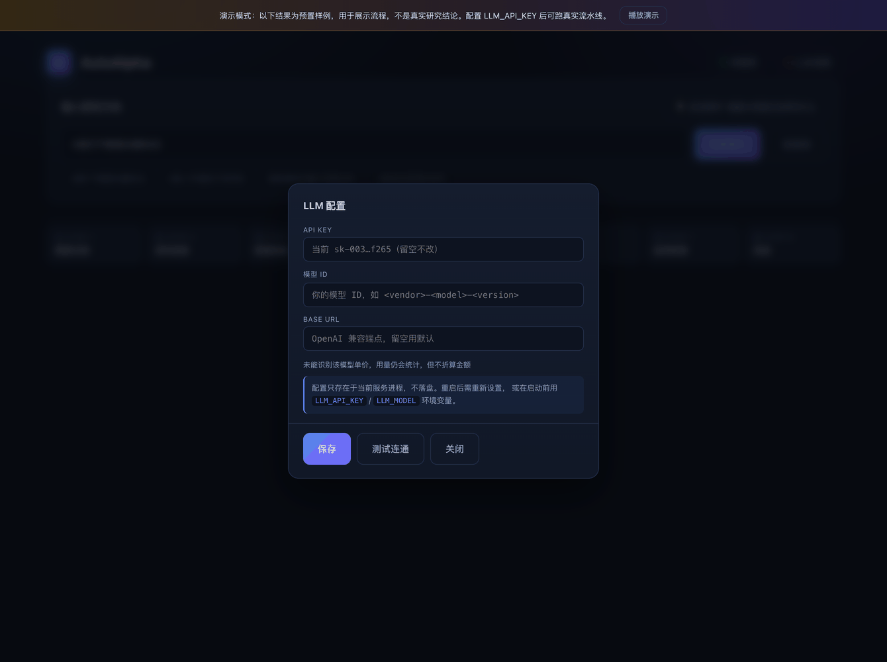
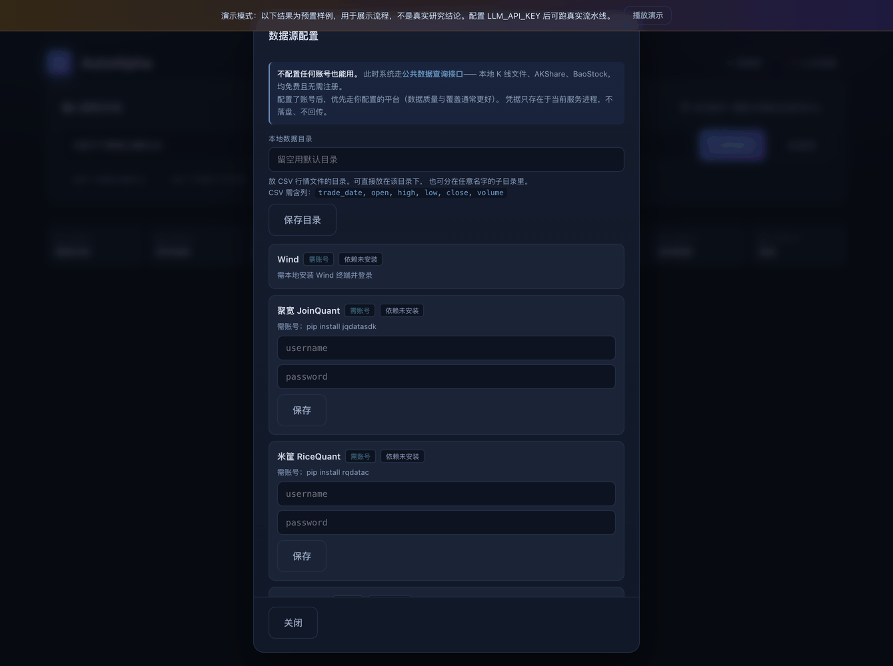
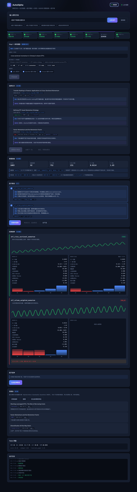

# AutoAlpha — 多Agent量化因子挖掘流水线

[](https://github.com/EdisonFu/autoalpha/actions/workflows/tests.yml)
[](https://github.com/EdisonFu/autoalpha/actions/workflows/lint.yml)
[](LICENSE)
[](pyproject.toml)

> 输入一个研究方向，自动检索文献与研报、提取因子假设、生成代码并做 IS/OOS 双层回测，输出可信的因子库。

**和同类项目的区别：多数 LLM 挖因子方案止步于 IC/ICIR，这个项目补了回测层。**

差别有多大？看一个真实的例子 —— 某动量因子 IC 为正、月度胜率 66%，
按 IC/ICIR 判定「有效」，但它的分层年化收益是：

```
Q1 +5.4%   Q2 +2.6%   Q3 -2.3%   Q4 +7.5%   Q5 -6.3%
                                            ↑ 最高分位反而最差
```

收益堆在中间层，多空组合恰好错过赚钱的层。**IC 显著 ≠ 能赚钱。**
只看 IC/ICIR 的系统会把这类因子放进因子库。

> ⚠️ 本项目是研究工具，不构成投资建议。通过门控 ≠ 可用于实盘。
> 详见 [DISCLAIMER.md](DISCLAIMER.md)。

---

## 功能概览

```
用户输入研究方向（如"动量因子"）
    │
    ▼
┌─────────────────┐
│  论文检索         │  搜索 arXiv q-fin 领域相关论文，LLM 语义打分，综合排序
└────────┬────────┘
         ▼
┌─────────────────┐
│  因子提取         │  LLM 从论文摘要中提取 2-4 个可量化因子假设
└────────┬────────┘
         ▼
┌─────────────────┐
│  因子实现         │  LLM 生成 Python 代码，沙箱（subprocess）执行，输出因子值 CSV
└────────┬────────┘
         ▼
┌─────────────────┐
│  因子评估         │  计算 IC/ICIR/衰减比/覆盖率/月胜率，与质量门控对比
└────────┬────────┘
         ▼
┌─────────────────┐
│  因子延伸         │  对通过评估的因子生成 3-5 个变体，自动评估
└────────┬────────┘
         ▼
┌─────────────────┐
│  生成报告         │  输出 HTML 因子质量报告 + 写入 SQLite 因子库
└─────────────────┘
```

---

## 界面一览

每张图都是真实运行界面（`scripts/capture_screens.py` 可重新生成）。

### 入口：说清你想研究什么


一句话描述研究方向即可。**建议带上市场**（如「A股」「港股」「美股」）——
不同市场的涨跌停、散户占比、做空限制差异很大，一个市场成立的结论往往不能平移。

### Step 1 · 意图识别：把口语翻译成学术检索式


这一步存在的理由很具体。同一个意图，表述不同召回量差 **800 倍**：

| 检索式 | 命中 |
|---|---|
| `ETF轮动` | 18 |
| `ETF rotation momentum` | 811 |
| `cross-sectional momentum exchange-traded fund` | 14,494 |

系统把输入归一成规范学术表述，识别市场、资产类别、因子族，
并用中文复述它的理解——**识别错了你能在检索前就改掉**，而不是跑完才发现跑偏。

### Step 2 · 资料检索：三个源并联，研报也要


| 源 | 覆盖 |
|---|---|
| arXiv | q-fin 预印本 |
| OpenAlex | 期刊 + 学位论文 + **机构研报**（NBER、Econstor） |
| Crossref | 期刊 + **SSRN 工作论文**（DOI 前缀 `10.2139`） |

实测单次召回 115 条、跨源去重后 110 条。每篇带**中文概述**与**相关性判断**，
不必逐篇读英文摘要。文献类型、期刊、被引数、命中来源都标在卡片上。

### Step 3 · 数据准备：先把截面弄干净


这一步不只是读数据，还在做两件容易被忽略的事：

**按资产类别筛池。** 全池 117 只 ETF 的年化波动极差达 **200 倍**
（国债 0.2% vs 原油 39.8%）。混在一个截面里做排序，结果会被资产类别主导
而不是因子强弱——分层单调性这个核心判据就失去意义。只保留股票类后极差降到 2.2 倍。

**门槛由数据推导而非写死。** `ic_mean_floor = t / √n_obs / √width`。
写死 0.02 是按 24 个标的算的；换成 92 个标的后它过严 2.3 倍。

### Step 4 · 因子假设：每个都讲清在做什么


从论文提取可实现的因子，每个给出**衡量什么 / 经济逻辑 / 计算要点**。
提取时会把可用数据告知模型，并明确禁止自行编造代理变量——
曾出现过模型一边声称可计算、一边偷偷用已实现波动率替代 VIX，
还沿用美股校准的阈值。

### Step 5 · 因子评估：IC 显著 ≠ 能赚钱


每个因子跑完整分层回测，样本内外并排呈现：

```
IS 层    t 值 > 推导门槛 · 分层单调性 > 0.6 · 多空Sharpe > 0.5 · 覆盖率 > 0.7 · 换手 < 上限
OOS 层   扣费后Sharpe > 0.3 · Sharpe衰减 > -50% · 单调性 > 0.4 · 净值相关 < 0.7
```

IS 没过的因子**不会访问 OOS 数据**——切分由引擎持有，不靠调用方自觉。

为什么要分层而不只看 IC？一个真实例子：某动量因子 IC 为正、月度胜率 66%，
但分层年化收益是 `+5.4% / +2.6% / -2.3% / +7.5% / -6.3%`——
**最高分位反而最差**。只看 IC/ICIR 的系统会把它判为有效。

### 配置：LLM 与数据源都在页面上



密钥、模型、Base URL 都可在页面设置，支持任意 OpenAI 兼容端点。
**单价由模型 ID 自动识别**，不用你去查价。密钥只回传掩码、只存进程内存、不落盘。
「测试连通」做一次最小调用，坏配置立刻暴露。



**不配置任何账号也能用**——此时走公共数据查询接口（本地 CSV、AKShare、BaoStock）。
配置了账号则优先走你的平台。依赖库没装会如实标注「暂不可用」，
而不是看起来成功、用时才失败。

### 灵感池：最近业界在研究什么



定期抓取 AlphaArchitect、Quantpedia、QuantInsti、NBER 的最新文章。
RSS 不支持按词检索，所以是「先抓取入库、再本地筛选」，
可按当前研究意图过滤。它回答的是「最近有什么新思路」，
而检索回答的是「关于 X 有哪些文献」。

---

## 文档

| 文件 | 内容 |
|---|---|
| [CLAUDE.md](CLAUDE.md) | 开发指引：约定与踩过的坑（动手前先读） |
| [CONTRIBUTING.md](CONTRIBUTING.md) | 如何参与 |
| [DISCLAIMER.md](DISCLAIMER.md) | 免责声明 |
| [docs/P0_BACKTEST_DESIGN.md](docs/P0_BACKTEST_DESIGN.md) | 回测层设计与实施记录 |
| [docs/E2E_REVIEW.md](docs/E2E_REVIEW.md) | 端到端复盘与实测结论 |
| [docs/TOKEN_COST.md](docs/TOKEN_COST.md) | 成本实测与省钱开关 |
| [docs/OPTIMIZATION_PLAN_2026Q4.md](docs/OPTIMIZATION_PLAN_2026Q4.md) | 文献调研与优化路线 |
| [README_WEB.md](README_WEB.md) | Web 控制台用法 |

---

## 因子质量门控

| 指标 | 门槛 | 说明 |
|------|------|------|
| IC 均值 | > 0.03 | 截面预测能力 |
| ICIR | > 0.5 | 信号稳定性 |
| IC 衰减比（5d/1d） | > 0.5 | 信号半衰期 |
| 因子覆盖率 | > 0.8 | 避免稀疏 |
| 月度胜率 | > 0.55 | IC > 0 的月份占比 |
| 与已有因子最大相关 | < 0.7 | 去相关 |

---

## 快速开始

### 1. 安装

```bash
git clone https://github.com/EdisonFu/autoalpha.git
cd autoalpha
pip install -e ".[anthropic]"      # 或 ".[openai]"，按你用的供应商
```

数据平台 SDK 是可选的 —— **不装也能用**，此时走公共数据查询接口。
需要接 Tushare 等平台时再装：`pip install -e ".[data,tushare]"`。

### 2. 配置 LLM API Key

```bash
export LLM_API_KEY=...                # 你的 LLM 密钥
export LLM_MODEL=<model-id>           # 模型 ID

# 若使用 OpenAI 兼容端点，再设置：
# export LLM_BASE_URL=https://.../v1

# 可选：按百万 token 计价，用于成本统计
# export LLM_PRICE_INPUT=3.0
# export LLM_PRICE_OUTPUT=15.0
```

### 3. 运行

```bash
python main.py
```

输入研究方向，例如：
```
❯ 动量因子选股策略
❯ 基于换手率的流动性因子
❯ 机器学习多因子模型
```

---

## 交互命令

| 命令 | 说明 |
|------|------|
| `<研究方向>` | 搜索论文并运行完整流水线 |
| `/library` | 查看已通过评估的因子库 |
| `/data <路径>` | 注册本地数据文件（CSV/Parquet/Excel） |
| `/source add tushare --token <TOKEN>` | 添加 VIP 数据源 |
| `/help` | 查看完整帮助 |
| `q` | 退出 |

---

## 项目结构

```
autoalpha/
├── main.py                          # 交互式 CLI 入口
├── requirements.txt
└── autoalpha/
    ├── llm.py                       # LLM 客户端（支持 多家 LLM 供应商）
    ├── pipeline.py                  # 主流水线编排
    ├── pipeline_state.py            # 数据结构：FactorSpec / FactorResult / FactorReport
    ├── db.py                        # SQLite 因子库
    ├── data_source.py               # 数据源适配器（AKShare/Tushare/Wind/聚宽/米筐）
    ├── local_data.py                # 本地数据自动识别加载
    ├── utils.py                     # 公共工具函数
    └── agents/
        ├── input_classifier.py      # 输入分类（idea/url/pdf/text）
        ├── paper_search_agent.py    # arXiv 论文检索 + LLM 语义排序
        ├── factor_extract_agent.py  # 从论文摘要提取因子假设
        ├── factor_implement_agent.py # LLM 生成因子代码 + 沙箱执行
        ├── factor_eval_agent.py     # IC/ICIR/衰减/覆盖率评估
        ├── factor_extension_agent.py # 生成因子延伸变体
        └── report_agent.py          # 生成 HTML 报告
```

---

## 数据源

默认使用 **AKShare**（免费，腾讯财经源）获取 CSI300 股票池日线数据。

支持接入 VIP 数据源：

```bash
# Tushare Pro
/source add tushare --token YOUR_TOKEN

# Wind（需本地安装 Wind 终端）
/source add wind

# 聚宽
/source add joinquant --username 手机号 --password 密码

# 米筐
/source add ricequant --username 账号 --password 密码

# 本地 CSV/Parquet 文件
/data ./my_factor_data.csv
```

---

## 输出

- **因子代码**：`./output/factors/<factor_name>_<timestamp>.py`
- **因子值 CSV**：`./output/factors/<factor_name>_<timestamp>.csv`
- **HTML 报告**：`./output/reports/factor_report_<timestamp>.html`
- **因子库**：`autoalpha.db`（SQLite）

---

## 技术栈

- **LLM**：任意 OpenAI 兼容或 Anthropic 协议端点（由 LLM_MODEL 指定）
- **数据**：AKShare（腾讯财经源）
- **IC 计算**：scipy.stats.spearmanr
- **代码沙箱**：subprocess 隔离执行（超时 120s）
- **存储**：SQLite
